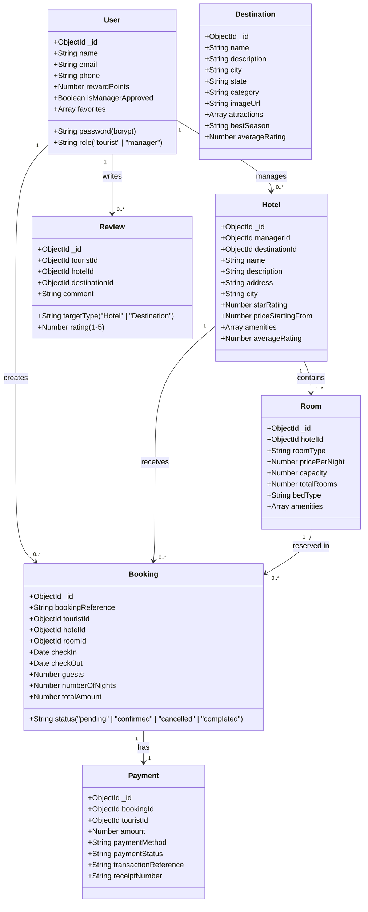

# Tourist Guide and Hotel Booking System
## Full-Stack MERN College Software Engineering Project

A college Software Engineering project developed using the **MERN Stack** (MongoDB, Express.js, React.js, Node.js).
Requirements, functional modules, and UML specifications are strictly guided by the **Project Review 1 PPT**, with design inspiration drawn from the secondary GitHub reference project.

---

## 📌 Executive Summary

This application bridges tourist guidance and accommodation booking into a single unified platform. Tourists can explore curated Indian destinations, discover points of interest, compare hotel properties side-by-side, reserve rooms with atomic availability verification, pay via a simulated PCI-compliant checkout, and download official electronic receipts. A dedicated **Hotel Manager Portal** allows hoteliers to manage listings, update room inventory, and process guest reservations.

---

## 🏗️ System Architecture & Technology Stack

```
Tourist_Guide_Project/
│
├── reference/
│   └── tourist-guide-app-main/       # Unmodified secondary reference project
│
└── my-project/                       # Independent full-stack MERN application
    ├── frontend/                     # React.js SPA (Vite)
    │   ├── public/
    │   ├── src/
    │   │   ├── components/           # Navbar, Footer, ProtectedRoute, Cards, StarRating, Modal
    │   │   ├── pages/                # 24 Application screens
    │   │   ├── context/              # AuthContext (JWT, state, user roles, points)
    │   │   ├── services/             # Centralized API service layer
    │   │   ├── App.jsx               # React Router DOM v7 client-side routing
    │   │   ├── App.css               # Modern design system & responsive styling
    │   │   ├── index.css             # Typography, color tokens & CSS resets
    │   │   └── main.jsx
    │   ├── package.json
    │   └── .env.example
    │
    ├── backend/                      # Node.js + Express.js REST API
    │   ├── config/                   # db.js (Mongoose connection & fallback)
    │   ├── models/                   # 7 Mongoose schemas matching UML Class Diagram
    │   ├── controllers/              # REST controllers for all modules
    │   ├── routes/                   # Modular Express routes
    │   ├── middleware/               # Auth (JWT), Role authorization, Error handler
    │   ├── utils/                    # Double-booking detector, receipt formatter, memoryStore
    │   ├── seed/                     # seedData.js & seeder.js
    │   ├── test-suite.js             # 20-test automated verification suite
    │   ├── server.js                 # Server entry point with CORS & body parser
    │   ├── package.json
    │   └── .env.example
    │
    ├── package.json                  # Root orchestration scripts
    └── README.md                     # Documentation & Verification Report
```

### Technology Selection:
- **Frontend**: React 19, Vite 8.3, JavaScript, CSS, React Router DOM v7, Lucide React icons.
- **Backend**: Node.js v24, Express.js, RESTful APIs, JWT (`jsonwebtoken`), `bcryptjs`.
- **Database**: MongoDB & Mongoose 8 (with dual resilience: real MongoDB Atlas/local Mongo and built-in fallback store for offline presentations).

---

## 🔑 Demo Accounts & Credentials

| Role | Email Address | Password | Permissions & Features |
| :--- | :--- | :--- | :--- |
| **Tourist** | `tourist@demo.com` | `password123` | Search destinations, filter hotels, compare stays, book rooms, make simulated payment, print receipts, earn reward points, write reviews. |
| **Hotel Manager** | `manager@demo.com` | `password123` | Manage hotel listings, add room types, update prices, adjust total room inventory, inspect guest reservations, update check-in status. |
| **Manager Secret Code** | `HOTEL_MANAGER_SECURE_2026` | — | Required during registration to prevent unauthorized manager role escalation. |

---

## 🚀 Quick Start Instructions

### 1. Starting the Full Application from `my-project/` Root

```bash
# Terminal 1 - Backend Server (Port 5000):
npm run backend

# Terminal 2 - Frontend Client (Port 5173):
npm run frontend
```

Open your browser at: **`http://localhost:5173`**

### 2. Running the Automated System Test Suite

```bash
npm test
```
*Executes all 20 requirement verification test cases covering authentication, double-booking prevention, payment simulation, role restrictions, and hotel manager APIs.*

### 3. Database Seeding (Optional)
If running a local MongoDB instance or Atlas connection:
```bash
npm --prefix backend run seed
```

---

## 📋 UML Class Diagram & Entity Relationships

The project implements the 6 core entities from **Page 8 of the Project Review PPT** plus the supporting `Room` entity:



---

## 🛡️ Key Algorithms & Security Implementations

### 1. Atomic Double-Booking Prevention Algorithm
Two reservations clash if and only if:
$$\text{Requested CheckIn} < \text{Existing CheckOut} \quad \text{AND} \quad \text{Requested CheckOut} > \text{Existing CheckIn}$$

In `availabilityHelper.js`, the system counts overlapping confirmed bookings for `roomId`:
```javascript
const overlappingCount = await Booking.countDocuments({
  roomId: room._id,
  status: 'confirmed',
  checkIn: { $lt: checkOutDate },
  checkOut: { $gt: checkInDate },
});
const availableRooms = Math.max(0, room.totalRooms - overlappingCount);
```
If `availableRooms === 0`, the booking is rejected immediately with an informative message.

### 2. Role Escalation Prevention
Normal tourists cannot select or register as a Hotel Manager without entering the secret verification code `MANAGER_SECRET_CODE`.

### 3. Zero Sensitive Card Credentials Stored
In compliance with PCI-DSS guidelines, credit card numbers, CVVs, and banking passwords are never transmitted or saved in MongoDB. The simulated payment gateway generates authentic transaction references (`TXN-SIM-XXXX`) and receipts (`REC-XXXX`).

---

## 📊 Requirement Verification Report

| Review PPT Requirement | Implemented Feature / Module | Relevant Screen / Component | Test Status |
| :--- | :--- | :--- | :--- |
| **Module 1: User Registration & Login** | JWT authentication, bcrypt hashing, profile updates, role authorization | `Login.jsx`, `Register.jsx`, `UserProfile.jsx` | ✅ PASSED (Test 7, 8, 9) |
| **Module 2: Destination & Attraction Search** | Browsing, multi-category filters, photo gallery, local attractions, travel tips | `Home.jsx`, `Destinations.jsx`, `DestinationDetails.jsx` | ✅ PASSED (Test 2, 3) |
| **Module 3: Hotel Search & Comparison** | City search, price slider (₹2k-25k), star filter, amenities, side-by-side comparison | `Hotels.jsx`, `HotelComparison.jsx`, `HotelDetails.jsx` | ✅ PASSED (Test 4, 5, 6) |
| **Module 4: Booking & Reservation** | Live availability, date validation, night calculation, booking history, cancellation | `BookingPage.jsx`, `MyBookings.jsx` | ✅ PASSED (Test 10, 11, 14) |
| **Module 5: Payment Processing** | Simulated gateway (Card, UPI, Net Banking), transaction references, electronic receipt | `PaymentPage.jsx`, `BookingConfirmation.jsx`, `ReceiptModal.jsx` | ✅ PASSED (Test 12) |
| **Module 6: Reviews & Ratings** | Star ratings (1-5), review submission, dynamic average rating calculation | `DestinationDetails.jsx`, `HotelDetails.jsx` | ✅ PASSED (Test 15) |
| **Hotel Manager Module** | Metrics dashboard, hotel listing CRUD, room inventory management, guest reservations | `ManagerDashboard.jsx`, `ManagerHotels.jsx`, `ManagerRooms.jsx`, `ManagerReservations.jsx` | ✅ PASSED (Test 16, 17, 18, 19) |
| **Double Booking Prevention** | Strict database overlapping check preventing clashing reservations | `availabilityHelper.js`, `bookingController.js` | ✅ PASSED (Test 13) |
| **Access Control Security** | Tourists blocked from accessing Hotel Manager APIs (HTTP 403) | `roleMiddleware.js`, `ProtectedRoute.jsx` | ✅ PASSED (Test 20) |

---

## 💻 Environment Variables Reference

### Backend (`my-project/backend/.env`)
```env
PORT=5000
NODE_ENV=development
MONGO_URI=mongodb://127.0.0.1:27017/tourist_guide_db
JWT_SECRET=tourist_guide_super_secret_jwt_key_2026
MANAGER_SECRET_CODE=HOTEL_MANAGER_SECURE_2026
CLIENT_URL=http://localhost:5173
```

### Frontend (`my-project/frontend/.env`)
```env
VITE_API_BASE_URL=http://localhost:5000/api
```
